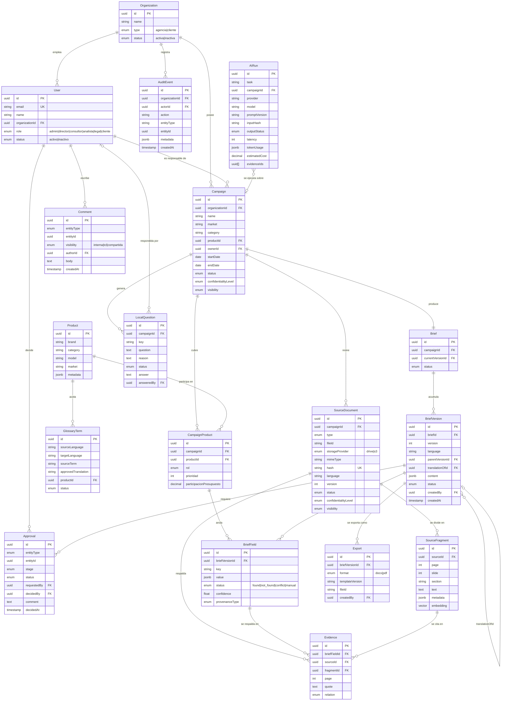

> **Documento histórico** (anterior a V2): no describe el modelo vigente; ver docs/project/V2_CURRENT_STATE.md y DEC-042 a DEC-050.

# D0-08 — Modelo de datos

**Versión:** 1 · **Fecha:** 11 de agosto de 2026 · **Estado:** propuesta para validación
**Fuentes:** documento maestro §10 (modelo canónico), §3.4 (regla de separación), §7.3 (estados), §12.2 (clasificación); `docs/decisions/decision-log.md` (DEC-005, DEC-009, DEC-012).

---

## 1. Diagrama entidad-relación (MVP 1)



---

## 2. Diccionario de datos

### 2.1 Organization

Organización propietaria de recursos. Es la raíz del aislamiento entre SmartPR y TCL.

| Campo | Tipo | Obligatorio | Descripción |
|---|---|:--:|---|
| `id` | uuid | Sí | Identificador |
| `name` | string | Sí | Nombre legal o comercial |
| `type` | enum | Sí | `agencia` \| `cliente` |
| `status` | enum | Sí | `activa` \| `inactiva` |

> **Regla:** todo recurso del sistema resuelve su `organizationId` directa o transitivamente. Es la base del criterio de aceptación de la Épica E2 (ningún usuario consulta recursos de otra organización).

### 2.2 User

| Campo | Tipo | Obligatorio | Descripción |
|---|---|:--:|---|
| `id` | uuid | Sí | Identificador |
| `email` | string | Sí | Único; proviene del proveedor OIDC |
| `name` | string | Sí | Nombre para mostrar y auditoría |
| `organizationId` | uuid | Sí | Organización a la que pertenece |
| `role` | enum | Sí | `admin` \| `director` \| `consultor` \| `analista` \| `legal` \| `cliente` (ver D0-07) |
| `status` | enum | Sí | `activo` \| `inactivo`. Nunca se elimina un usuario con historial de auditoría |

### 2.3 Campaign

| Campo | Tipo | Obligatorio | Descripción |
|---|---|:--:|---|
| `id` | uuid | Sí | Identificador |
| `organizationId` | uuid | Sí | Propietaria (SmartPR) |
| `name` | string | Sí | Nombre de la campaña |
| `market` | string | Sí | Mercado destino (por defecto `CO`) |
| `category` | string | No | Categoría de producto |
| ~~`productId`~~ | — | — | **Eliminado en DEC-016.** Los productos viven en `CampaignProduct`; una campaña admite varios |
| `ownerId` | uuid | Sí | Consultor responsable |
| `startDate` / `endDate` | date | No | Ventana de ejecución |
| `status` | enum | Sí | `activa` \| `archivada` \| `cancelada` |
| `confidentialityLevel` | enum | Sí | §12.2 — por defecto `interna` |
| `visibility` | enum | Sí | `interna` \| `tcl` \| `compartida` |

### 2.4 Product

| Campo | Tipo | Obligatorio | Descripción |
|---|---|:--:|---|
| `id` | uuid | Sí | Identificador |
| `brand` | string | Sí | Marca (`TCL` por defecto) |
| `category` | string | Sí | TV, audio, electrodoméstico, móvil |
| `model` | string | Sí | Referencia comercial |
| `market` | string | No | Mercado donde ya fue lanzado — relevante para DEC-008 |
| `metadata` | jsonb | No | Especificaciones técnicas estructuradas |

### 2.4 bis · CampaignProduct

Relación entre campaña y producto, con el papel que el producto juega en esa campaña (DEC-016).

| Campo | Tipo | Obligatorio | Descripción |
|---|---|:--:|---|
| `id` | uuid | Sí | Identificador |
| `campaignId` | uuid | Sí | Campaña |
| `productId` | uuid | Sí | Producto |
| `rol` | enum | Sí | `flagship` \| `secundario` \| `entrada` \| `unico` |
| `prioridad` | int | Sí | 1 = mayor. Ordena el esfuerzo de contenidos |
| `participacionPresupuesto` | decimal | No | Fracción 0–1 del presupuesto de campaña |

**Por qué existe como entidad y no como una lista de IDs:** el brief P80 no solo declara tres productos — declara que el Ultra es el flagship, que se lleva el 60% del presupuesto y que va primero en prioridad. Esa información pertenece a la relación, no al producto (el mismo P80 Ultra podría ser secundario en una campaña de temporada).

**Restricción:** `UNIQUE(campaignId, productId)` — un producto no aparece dos veces en la misma campaña.

**Regla de negocio no impuesta por el esquema:** las participaciones de presupuesto de una campaña deberían sumar 1. El brief P80 declara 0.6 / 0.2 / 0.1 = 0.9. No se rechaza —puede ser deliberado— pero genera una `LocalQuestion` al consultor.

### 2.5 SourceDocument

| Campo | Tipo | Obligatorio | Descripción |
|---|---|:--:|---|
| `id` | uuid | Sí | Identificador |
| `campaignId` | uuid | Sí | Campaña a la que pertenece |
| `type` | enum | Sí | `ppt_global` \| `ficha_tecnica` \| `brief_cliente` \| `imagen` \| `otro` (ver D0-04) |
| `fileId` | string | Sí | ID de Drive o clave S3 — **nunca el nombre del archivo** (§10.3) |
| `storageProvider` | enum | Sí | `drive` \| `s3` |
| `mimeType` | string | Sí | Validado contra la lista de DEC-010 |
| `hash` | string | Sí | SHA-256 del original; detecta duplicados y cambios |
| `language` | string | No | Idioma detectado |
| `version` | int | Sí | Versión del documento fuente |
| `status` | enum | Sí | `pendiente` \| `procesando` \| `procesado` \| `fallido` |
| `confidentialityLevel` | enum | Sí | §12.2 |
| `visibility` | enum | Sí | Hereda de la campaña salvo restricción explícita |

### 2.6 SourceFragment

| Campo | Tipo | Obligatorio | Descripción |
|---|---|:--:|---|
| `id` | uuid | Sí | Identificador |
| `sourceId` | uuid | Sí | Documento de origen |
| `page` / `slide` | int | No | Ubicación exacta; al menos uno debe estar presente para poder citar |
| `section` | string | No | Sección o título |
| `text` | text | Sí | Texto extraído |
| `metadata` | jsonb | No | Idioma, producto, tipo de contenido |
| `embedding` | vector | No | pgvector; **hereda organización, campaña, idioma, versión y permiso del documento origen** (§10.3) |

### 2.7 Brief y BriefVersion

**Brief** es el contenedor estable; **BriefVersion** es lo que realmente se lee y aprueba.

| Campo (Brief) | Tipo | Obligatorio | Descripción |
|---|---|:--:|---|
| `id` | uuid | Sí | Identificador |
| `campaignId` | uuid | Sí | Una campaña tiene un brief |
| `currentVersionId` | uuid | No | Versión vigente en español |
| `status` | enum | Sí | Refleja el estado de la versión vigente |

| Campo (BriefVersion) | Tipo | Obligatorio | Descripción |
|---|---|:--:|---|
| `id` | uuid | Sí | Identificador |
| `briefId` | uuid | Sí | Brief al que pertenece |
| `version` | int | Sí | Correlativo por brief e idioma |
| `language` | string | Sí | `es` \| `en` |
| `parentVersionId` | uuid | No | Versión de la que deriva en el mismo idioma |
| `translationOfId` | uuid | No | Versión de origen si es una traducción |
| `content` | jsonb | Sí | Instancia validada contra el JSON Schema de D0-05 |
| `status` | enum | Sí | Los doce estados de §7.3 |
| `createdBy` | uuid | Sí | Autor |
| `createdAt` | timestamp | Sí | Fecha de creación |

> **Regla de inmutabilidad (ADR-003):** una versión en estado `approved` no admite `UPDATE` sobre `content`. La restricción se implementa en la capa de dominio **y** con un trigger en base de datos — no solo en la aplicación, porque una migración o un script podrían saltarse la primera.

### 2.8 BriefField

Descompone `BriefVersion.content` en campos consultables individualmente. Existe porque la evidencia y la confianza se atribuyen **por campo**, no por documento.

| Campo | Tipo | Obligatorio | Descripción |
|---|---|:--:|---|
| `id` | uuid | Sí | Identificador |
| `briefVersionId` | uuid | Sí | Versión a la que pertenece |
| `key` | string | Sí | Ruta canónica del campo. En campañas multiproducto lleva el producto: `marca_producto[prd-p80-ultra].rtbs` (DEC-016) |
| `campaignProductId` | uuid | No | Ancla el campo a un producto concreto. Nulo si el campo es de nivel campaña |
| `value` | jsonb | No | Valor; nulo si `status = not_found` |
| `status` | enum | Sí | `found` \| `not_found` \| `conflict` \| `manual` |
| `confidence` | float | No | 0–1; nulo cuando el origen es manual |
| `provenanceType` | enum | Sí | `extracted` \| `inferred` \| `manual_local` \| `translated` |

> **Regla (§9.4):** un campo con `status = found` que sea claim o dato técnico **debe** tener al menos una `Evidence`. Un campo sin evidencia no puede formar parte de una versión aprobable.

### 2.9 Evidence

| Campo | Tipo | Obligatorio | Descripción |
|---|---|:--:|---|
| `id` | uuid | Sí | Identificador |
| `briefFieldId` | uuid | Sí | Campo que respalda |
| `sourceId` | uuid | Sí | Documento fuente |
| `fragmentId` | uuid | No | Fragmento exacto |
| `page` | int | No | Página o diapositiva |
| `quote` | text | Sí | Cita literal — permite verificar sin abrir el original |
| `relation` | enum | Sí | `soporta` \| `contradice` \| `contexto` |

### 2.10 LocalQuestion

| Campo | Tipo | Obligatorio | Descripción |
|---|---|:--:|---|
| `id` | uuid | Sí | Identificador |
| `campaignId` | uuid | Sí | Campaña |
| `key` | string | Sí | Campo del brief al que apunta |
| `question` | text | Sí | Pregunta redactada para una persona |
| `reason` | text | Sí | Por qué se generó (`vacío` o `contradicción entre fuentes X e Y`) |
| `status` | enum | Sí | `pendiente` \| `respondida` \| `descartada` |
| `answer` | text | No | Respuesta |
| `answeredBy` | uuid | No | Quién respondió |

> Una pregunta descartada exige justificación en `answer` — descartar sin motivo deja un vacío invisible.

### 2.11 Approval, Comment, GlossaryTerm, Export

| Entidad | Campos | Nota clave |
|---|---|---|
| **Approval** | `entityType`, `entityId`, `stage`, `status`, `requestedBy`, `decidedBy`, `comment`, `decidedAt` | `stage` distingue `interna` de `cliente`. La aprobación de cliente se **registra** manualmente (DEC-012), no se ejecuta en el sistema |
| **Comment** | `entityType`, `entityId`, `visibility`, `authorId`, `body`, `createdAt` | `visibility` separa comentario interno de comentario visible para TCL |
| **GlossaryTerm** | `sourceLanguage`, `targetLanguage`, `sourceTerm`, `approvedTranslation`, `productId`, `status` | Un término en `aprobado` queda **bloqueado** en la traducción automática |
| **Export** | `briefVersionId`, `format`, `templateVersion`, `fileId`, `createdBy` | `templateVersion` permite reproducir exactamente un export antiguo |

### 2.12 AuditEvent y AIRun

Cumplen funciones distintas y **ninguno reemplaza al otro** (§10.3).

| | AuditEvent | AIRun |
|---|---|---|
| **Responde a** | ¿Quién hizo qué y cuándo? | ¿Qué hizo el modelo, con qué costo y con qué fuentes? |
| **Se genera en** | Toda mutación sensible | Toda ejecución de tarea de IA |
| **Actor** | Siempre una persona | Siempre el sistema |
| **Se conserva** | Indefinidamente | Según política de retención |

| Campo (AIRun) | Tipo | Descripción |
|---|---|---|
| `task` | string | `extract` \| `detect_gaps` \| `translate` \| `draft` \| `search_evidence` |
| `provider` / `model` / `promptVersion` | string | Permiten reproducir y comparar entre versiones |
| `inputHash` | string | Detecta reejecuciones idénticas |
| `outputStatus` | enum | `ok` \| `schema_invalid` \| `error` \| `timeout` |
| `latency` / `tokenUsage` / `estimatedCost` | int / jsonb / decimal | Observabilidad de costo (§2.3) |
| `evidenceIds` | uuid[] | Fragmentos efectivamente usados |

> **`logs sin contenido sensible` (Épica E11):** `AIRun` guarda hashes y metadatos, no el texto del prompt ni la respuesta completa.

---

## 3. Reglas de integridad

Traducción directa de §10.3 a restricciones verificables:

| # | Regla | Implementación |
|---|---|---|
| 1 | No sobrescribir una versión aprobada | Trigger en BD + validación de dominio |
| 2 | Cada traducción apunta a su versión de origen | `translationOfId` obligatorio cuando `language ≠ es` |
| 3 | Toda aprobación registra actor y fecha | `decidedBy` y `decidedAt` no nulos cuando `status ≠ pendiente` |
| 4 | Cada mutación sensible genera AuditEvent | Middleware en la capa de dominio |
| 5 | El vínculo con Drive usa `fileId`, nunca el nombre | `SourceDocument.fileId` obligatorio; el nombre es solo visualización |
| 6 | `AIRun` no reemplaza `AuditEvent` | Tablas separadas, ciclos de vida distintos |
| 7 | Los embeddings heredan permisos del origen | Filtro obligatorio en toda consulta vectorial |
| 8 | Un claim aprobado tiene evidencia | Validación previa a la transición a `approved` |

**Sobre la regla 8:** es la que sostiene el umbral de "100% de claims con evidencia" (§15). Si se implementa solo como advertencia en la interfaz, el umbral no se cumple. Debe bloquear la transición.

---

## 4. Campos transversales de separación

Presentes en todo recurso consultable (§3.4):

```
organizationId · campaignId · confidentialityLevel · visibility · createdBy · createdAt · version
```

**Relación con DEC-009:** se autorizó usar datos reales sin anonimizar en esta etapa, pero `confidentialityLevel` y `visibility` se implementan desde el día uno. Activar anonimización más adelante será una política sobre campos que ya existen, no una migración del esquema.

---

## 5. Entidades reservadas para evolución

No requieren interfaz ni tabla en MVP 1, pero el diseño no debe bloquearlas (§10.2). Se listan para que ninguna decisión de MVP 1 las haga imposibles:

`Influencer` · `MediaOutlet` · `Journalist` · `CampaignCreator` · `Deliverable` · `ScriptVersion` · `ContentAsset` · `ContractDocument` · `ProductAsset` · `Publication` · `MetricDefinition` · `MetricSnapshot` · `Evaluation` · `Task` · `Alert`

**Tres decisiones de MVP 1 que las protegen:**

1. `Approval` y `Comment` son **polimórficos** (`entityType` + `entityId`): sirven para briefs hoy y para guiones o videos mañana, sin duplicar tablas.
2. El estado de colaboración vivirá en `CampaignCreator`, no en `Campaign` (§4.2). `Campaign.status` se mantiene deliberadamente simple para no tener que vaciarlo después.
3. `SourceDocument.type` es un enum extensible: guiones y contratos entrarán como tipos nuevos, no como tablas nuevas.

---

## 6. Cobertura de la Definition of Done

| Requisito (§23.1) | Estado |
|---|---|
| Modelo de datos con ERD y diccionario | ✅ 17 entidades con diccionario completo |
| Sin campos críticos "por decidir" sin responsable | ✅ Ver §7 — los tres pendientes tienen responsable y momento de resolución |
| Soporta versionado inmutable | ✅ Reglas 1 y 2, con implementación especificada |
| Soporta relación evidencia–campo | ✅ `BriefField` ↔ `Evidence`, regla 8 |
| Soporta aislamiento entre organizaciones | ✅ §4, campos transversales |

## 7. Pendientes

| Punto | Impacto | Responsable | Cuándo |
|---|---|---|---|
| ~~¿`Campaign` puede tener más de un producto?~~ | **Resuelto en DEC-016**: sí, vía `CampaignProduct` | — | 11 ago 2026 |
| ¿Se permite revertir una aprobación interna? | Medio — añadiría un estado al ciclo | Product owner | Antes de Épica E8 |
| Política de retención de `AIRun` | Bajo — afecta costo de almacenamiento, no funcionalidad | Product owner | Antes del piloto |
