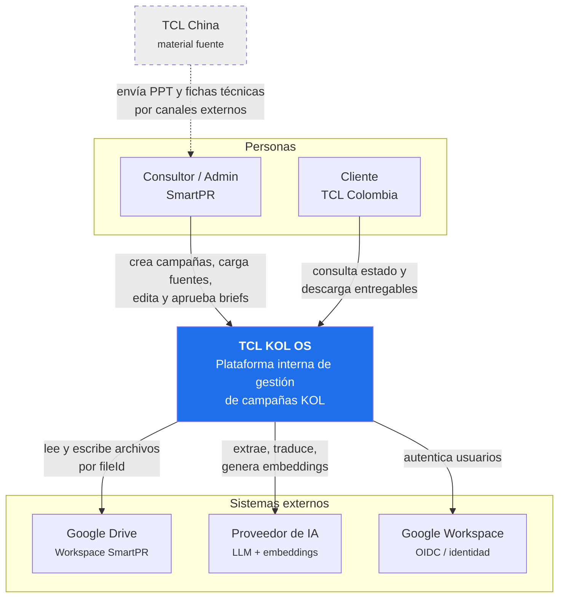
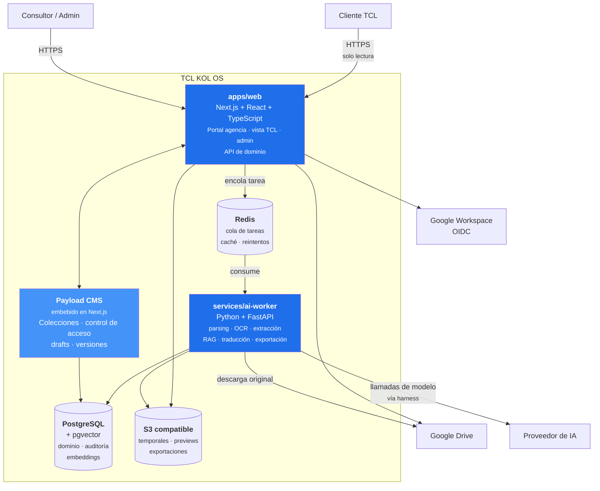
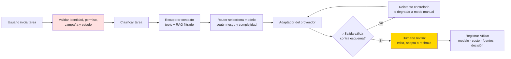
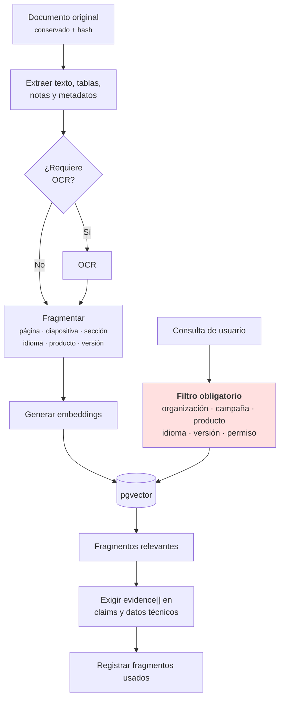

# D0-09 — Arquitectura

**Versión:** 1 · **Fecha:** 11 de agosto de 2026 · **Estado:** propuesta para validación
**Anexo obligatorio:** [`../security/D0-09-seguridad-continuidad.md`](../security/D0-09-seguridad-continuidad.md)
**Fuentes:** documento maestro §8 (arquitectura), §9 (arquitectura de IA), §11 (contratos de API), §12 (seguridad); `docs/decisions/decision-log.md` (ADR-001, ADR-004, ADR-005, DEC-005 a DEC-008).

---

## 1. Decisión de fondo

**Monolito modular con procesos asíncronos separados.** No hay Kubernetes ni una red de microservicios (§8). Esta decisión está registrada como ADR-001 y no se reabre aquí.

Tres razones que sostienen la elección para MVP 1:

1. **Un solo usuario piloto** (DEC-011). La complejidad operativa de microservicios no compra nada a esta escala.
2. **Todo corre local** (DEC-007). Docker Compose debe levantar el sistema completo en la máquina del product owner.
3. **El acoplamiento peligroso no es entre servicios, sino entre dominio e IA.** Se resuelve con adaptadores dentro del monolito (§4 de este documento), no partiendo el despliegue.

---

## 2. C4 nivel 1 — Contexto



**TCL China aparece con línea punteada y fuera del sistema**: entrega material por canales externos (correo, Drive compartido) y el consultor lo carga manualmente. No es usuario ni integración (DEC-003, D0-07 §3).

---

## 3. C4 nivel 2 — Contenedores



### 3.1 Responsabilidad de cada contenedor

| Contenedor | Responsabilidad | Lo que **no** hace |
|---|---|---|
| **apps/web** | Interfaz de agencia, vista de TCL, panel admin, API de dominio, transiciones de estado, permisos | No llama al proveedor de IA directamente; no parsea documentos |
| **Payload CMS** | Colecciones, control de acceso por colección, drafts, versiones, panel administrativo | No define la lógica de negocio de transiciones — esa vive en `packages/domain` |
| **services/ai-worker** | Parsing PPTX/PDF/DOCX, OCR, fragmentación, embeddings, extracción estructurada, traducción, generación de DOCX/PDF | No decide estados ni permisos; recibe trabajo y devuelve resultado validado |
| **PostgreSQL + pgvector** | Fuente de verdad del dominio, auditoría y búsqueda vectorial | No almacena archivos originales |
| **Redis** | Cola de tareas largas, reintentos, control de concurrencia | **No conserva estado de negocio definitivo** (§8.2) — si se pierde Redis, no se pierde información |
| **S3 compatible** | Derivados regenerables: previews, exportaciones, temporales | No es fuente de verdad; todo lo que contiene puede reconstruirse |
| **Google Drive** | Archivos originales | No es el índice; la aplicación guarda `fileId`, no el archivo |

### 3.2 Por qué Python separado de Next.js

La separación **no** es por escalabilidad, es por ecosistema: el parsing de PPTX/PDF con localización de página y diapositiva, el OCR y los pipelines de embeddings tienen librerías maduras en Python que no tienen equivalente razonable en Node. Mantener esa complejidad fuera del proceso web también evita que un parseo de un PPT de 80 MB bloquee la interfaz.

El worker **no tiene autoridad**: recibe un trabajo con su contexto ya autorizado, y devuelve un resultado que la capa de dominio valida antes de persistir.

---

## 4. Arquitectura de IA — el harness



En rojo, el punto donde se aplica la autorización — **antes** de cualquier llamada al modelo, nunca después. En amarillo, el punto donde una persona decide (ADR-002).

### 4.1 Adaptadores de proveedor

El criterio de aceptación de la Épica E11 es concreto: *"cambiar un adaptador no exige modificar la lógica del dominio"*. Esto se logra con una interfaz estable:

```
packages/domain/ai/
  ├── ports.ts          ← interfaz que el dominio conoce
  ├── router.ts         ← elige nivel de modelo por tarea y riesgo
  └── adapters/
      ├── anthropic.ts
      ├── openai.ts
      └── local.ts      ← permite correr sin proveedor externo
```

El dominio conoce `ports.ts` y nada más. DEC-008 dejó abierto el proveedor; esta estructura hace que la decisión sea reversible sin costo.

### 4.2 Niveles de modelo por tarea (§9.2)

| Tarea | Nivel | Control humano |
|---|---|---|
| Extraer campos | Eficiente | Confirmación de campos críticos |
| Detectar vacíos | Equilibrado | El consultor responde |
| Traducir ES/EN | Eficiente + glosario | Revisión técnica |
| Redactar brief | Equilibrado | Edición y aprobación |
| Encontrar evidencia | Sin generación o eficiente | Evidencia visible |
| Resolver ambigüedad | Avanzado, solo si aporta | **Nunca aprobación automática** |

### 4.3 Feature flag de IA

Un interruptor desactiva la asistencia de IA sin desplegar código nuevo. Con la IA apagada, el sistema sigue permitiendo crear, editar, versionar, traducir manualmente, aprobar y exportar briefs. Esto es el principio 9 del §5 y el criterio de aceptación de la Épica E7: *"una falla del worker no impide completar y guardar el brief manualmente"*.

---

## 5. RAG y filtrado obligatorio



**La regla que no puede relajarse:** el filtro por permisos se aplica **en la consulta**, no como post-filtrado de resultados. Una búsqueda vectorial nunca puede devolver un fragmento que el usuario no podría abrir directamente (§10.3, regla 7).

---

## 6. Límites de módulos

```text
apps/web
  portal agencia · vista TCL · admin · API de dominio

services/ai-worker
  parsing · OCR · extracción · RAG · traducción · exportación

packages/domain
  tipos · estados · permisos · esquemas · eventos · puertos de IA

packages/ui
  componentes compartidos

packages/evals
  gold set · métricas · pruebas de prompts y modelos
```

**Regla de dependencia:** `apps/web` y `services/ai-worker` dependen de `packages/domain`. `packages/domain` **no depende de ninguno de los dos**. Las transiciones de estado y las reglas de permiso viven ahí y son la única implementación — no se duplican en la interfaz ni en el worker.

Esto es lo que hace verificable el estándar de §27: *"funciones de dominio separadas de controladores y componentes"*.

---

## 7. Entornos y despliegue

| Entorno | Dónde corre | Datos | Estado hoy |
|---|---|---|---|
| **Desarrollo** | Máquina local del product owner, Docker Compose | Reales sin anonimizar (DEC-009) | **Único entorno activo** |
| **Staging / QA** | Servidor propio de la agencia ("BPS": ~16 GB RAM, ~100 GB) | Copias controladas | Previsto cuando la UI/UX esté estable (DEC-007) |
| **Producción** | Sin definir | Datos reales | No existe |

**Criterio de aceptación de la Épica E1:** una persona nueva puede ejecutar el proyecto desde el README siguiendo pasos reproducibles. En la práctica: `docker compose up` levanta web, worker, Postgres y Redis; el `.env.example` documenta cada variable sin contener secretos.

> **ADR-005 — riesgo aceptado:** no hay backup externo gestionado mientras todo corra local. El product owner lo aceptó explícitamente y se revisará cuando exista UI/UX funcional. Detalle y plan de mitigación en el [anexo de seguridad](../security/D0-09-seguridad-continuidad.md) §4.

---

## 8. Observabilidad

| Qué se observa | Cómo | Dónde queda |
|---|---|---|
| Errores de aplicación | Sentry o equivalente | Servicio externo |
| Trazas y latencia | OpenTelemetry | Logs estructurados |
| Costo y consumo de IA | Registro `AIRun` por ejecución | PostgreSQL |
| Acciones de usuario | `AuditEvent` | PostgreSQL |
| Salud del sistema | `GET /api/health` · `GET /api/ready` | Endpoints |

**Todo log lleva `requestId`** y ninguno contiene prompts de sistema, tokens, contenido sensible ni PII (§11.6, Épica E11).

`AIRun` y `AuditEvent` responden preguntas distintas y ninguno reemplaza al otro (§10.3, regla 6): el primero explica qué hizo el modelo y cuánto costó; el segundo, qué hizo una persona.

---

## 9. Decisiones nuevas de este documento

Las siguientes decisiones surgen del diseño arquitectónico y se registran como ADR en `docs/decisions/decision-log.md` — **no se crea un formato de ADR paralelo**.

| ADR | Decisión |
|---|---|
| **ADR-006** | Payload CMS embebido en Next.js, no como servicio separado |
| **ADR-007** | Redis no conserva estado de negocio; toda tarea es reconstruible desde PostgreSQL |
| **ADR-008** | `packages/domain` sin dependencias hacia `apps/` ni `services/` |

---

## 10. Cobertura de la Definition of Done

| Requisito (§23.1) | Estado | Dónde |
|---|---|---|
| Arquitectura documentada con C4 o equivalente + ADR | ✅ | §2, §3, §9 |
| Incluye **seguridad** | ✅ | Anexo completo |
| Incluye **backups** | ⚠️ Documentado como riesgo aceptado con plan de salida | Anexo §4 |
| Incluye **observabilidad** | ✅ | §8 |
| Incluye **fallback manual** | ✅ | §4.3 |
| Sin campos críticos "por decidir" sin responsable | ✅ | §11 |

## 11. Pendientes con responsable

Ningún campo queda como "por decidir" sin dueño y sin fecha:

| # | Punto abierto | Responsable | Cuándo se resuelve | ¿Bloquea MVP 1? |
|---|---|---|---|---|
| 1 | Proveedor de IA concreto | Product owner | Antes del Sprint 3 (extracción) | No — el adaptador lo aísla |
| 2 | Servicio de observabilidad (Sentry vs. alternativa) | Product owner | Antes del Sprint 7 | No |
| 3 | Storage S3 compatible concreto | Product owner | Antes del Sprint 2 | No — puede usarse MinIO local |
| 4 | Destino de producción | Product owner | Después del piloto | No |
| 5 | Migración a backup externo | Product owner | Cuando exista UI/UX funcional (ADR-005) | No — riesgo aceptado |
| 6 | Modelo de embeddings | Product owner | Antes del Sprint 3 | No — el adaptador lo aísla |

**Los seis pendientes comparten una propiedad:** ninguno bloquea la construcción, porque la arquitectura los aísla detrás de adaptadores o los difiere a después del piloto. Esa es exactamente la razón por la que la arquitectura se diseñó así.
