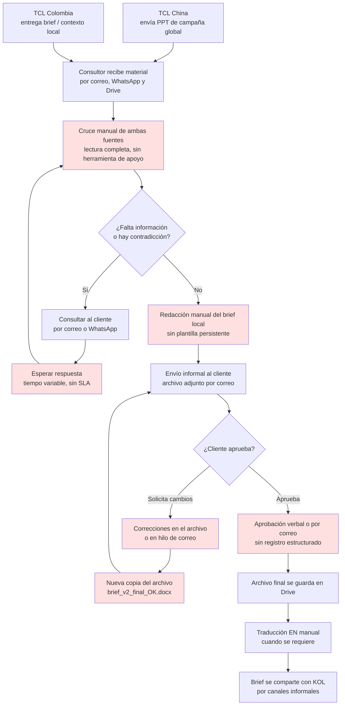

# D0-02 — Mapa AS-IS del proceso actual

> ✅ **VALIDADO PARCIALMENTE CON MATERIAL REAL** — 11 de agosto de 2026
>
> Los dolores **5, 6, 7 y 8** (claims sin fuente, versionado por nombre de archivo, correcciones dispersas y aprobación sin registro) quedaron confirmados con evidencia directa del material operativo de SmartPR. Ver [D0-14 §2 y §3](D0-14-linea-base.md).
>
> Los dolores **1, 2, 3, 4, 9 y 10** siguen apoyados solo en la entrevista de descubrimiento: el material recibido documenta propuestas de KOL y seguimiento de guiones, no el ciclo de construcción del brief.
>
> **Lo que sigue sin medirse:** la duración del ciclo y el número de rondas de corrección del brief. Este documento no debe usarse para afirmar una reducción porcentual de tiempo (§15) mientras eso no exista.

**Versión:** 2 (validado parcialmente) · **Fecha:** 11 de agosto de 2026
**Fuentes:** documento maestro §1.1, §3, §4; `docs/decisions/decision-log.md` (DEC-003, DEC-004, DEC-005); material operativo real analizado en D0-14.

---

## 1. Actores del proceso actual

| Actor | Papel real hoy |
|---|---|
| **TCL China** | Entrega material global de campaña (PPT, fichas técnicas). No aprueba ni participa en el proceso local. |
| **TCL Colombia (cliente)** | Entrega contexto local, objetivos de negocio y restricciones. Da el visto bueno final al brief. |
| **Consultor / PR Manager (SmartPR)** | Cruza ambas fuentes, construye el brief, gestiona correcciones y coordina con los KOL. |
| **KOL / influencer** | Recibe el brief ya aprobado por canales informales. Fuera del alcance de este mapa. |

---

## 2. Flujo actual

Los bloques marcados en rojo son los puntos donde se concentra el trabajo repetitivo y la pérdida de trazabilidad.

---

## 3. Puntos de dolor identificados

Tomados de la columna "Situación actual" del documento maestro (§1.1) y de las respuestas de descubrimiento.

| # | Punto de dolor | Consecuencia observable | Etapa | Evidencia |
|---|---|---|---|---|
| 1 | Información distribuida entre PPT, correo, WhatsApp y Drive | No existe un contenedor único por campaña; reconstruir el contexto exige buscar en cuatro canales | C | Entrevista |
| 2 | Cruce manual entre material de China y del cliente | Trabajo repetitivo en cada campaña; el resultado depende de quién lo haga | D | Entrevista |
| 3 | Consultas de información faltante sin estructura ni SLA | Tiempos muertos no medidos esperando respuesta del cliente | F, G | Entrevista |
| 4 | Brief redactado sin plantilla persistente | Cada brief puede tener secciones distintas; los campos críticos se omiten por olvido | H | Entrevista + 4 formatos distintos recibidos |
| 5 | Claims y datos técnicos sin fuente citada | No se puede verificar de dónde salió una especificación sin volver al PPT original | H | ✅ **Medido: 0% de claims con fuente.** Corrección manual real: *"cuando habla de la tasa de refresco que diga 288hz vrr o sino 144hz nativos"* |
| 6 | Versionado por nombre de archivo | Proliferación de copias sin saber cuál rige | K, L | ✅ **Medido: 8 versiones de A400 Pro.** Marcadores en el nombre: `_Ajuste`, `_APROBADO`, `completo`, `_130426`, `_240426` |
| 7 | Correcciones dispersas en hilos de correo | El histórico de por qué cambió algo se pierde | K | ✅ **Medido: solo 3% de la retroalimentación se conserva** (4 de 124 entregables) |
| 8 | Aprobación sin registro estructurado | No queda constancia de quién aprobó qué versión ni cuándo | M | ✅ **Medido: 14% de entregables sin estado registrado**; ningún cambio de estado lleva fecha ni actor |
| 9 | Traducción EN manual y desvinculada | ES y EN pueden divergir sin que nadie lo detecte | O | Entrevista |
| 10 | Sin histórico comparable entre campañas | No hay aprendizaje acumulado ni línea base de desempeño | N, P | ✅ **Parcial: 43% de guiones sin archivo vinculado**; los vínculos existentes son nombres sueltos (`GUION Douglas (1).docx`) |

Detalle completo de las mediciones en [D0-14 §2 y §3](D0-14-linea-base.md).

---

## 4. Qué no cubre este mapa

- **Etapas posteriores al brief** (selección de KOL, gestión de producto, revisión de guion, publicación, medición y cierre). Existen en el proceso real y están descritas en el flujo objetivo (§4 del maestro), pero MVP 1 no las interviene.
- **Tiempos, número de rondas y tasa de error reales.** Es exactamente el contenido de D0-14 y requiere datos operativos.
- **Variaciones por tipo de campaña.** Es probable que una campaña con producto ya lanzado en otros mercados siga un camino más corto que un lanzamiento nuevo; no se ha verificado.

---

## 5. Qué se necesita para validar este mapa

| Insumo | Para qué |
|---|---|
| Material completo de 5–10 campañas reales cerradas | Confirmar que el flujo dibujado corresponde a la práctica y no a la descripción idealizada |
| Hilos de correo o registros de las rondas de corrección | Medir número real de rondas (punto de dolor 6 y 7) |
| Fechas de recepción de material y de aprobación final | Calcular el tiempo del ciclo actual — indicador principal de §2.3 |
| Al menos un caso donde algo salió mal | Identificar los modos de falla que el flujo feliz no muestra |

Estos insumos alimentan simultáneamente **D0-14** y la validación de este documento. Al recibirlos, este mapa pasa de borrador a versión aprobada y se retira el aviso del encabezado.
