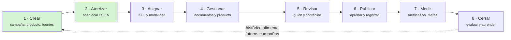
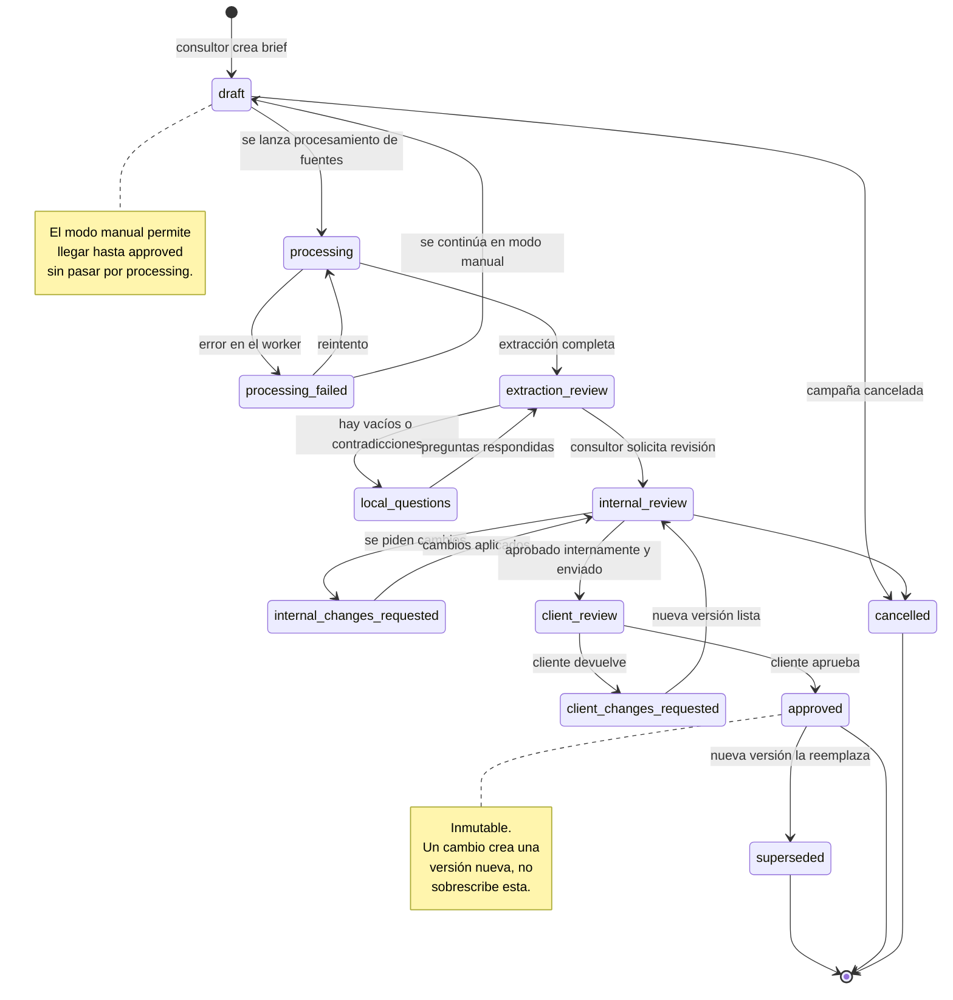

# D0-03 — Flujo TO-BE

**Versión:** 1 · **Fecha:** 11 de agosto de 2026 · **Estado:** propuesta para validación
**Fuentes:** documento maestro §4 (flujo operativo), §4.2 (estado por colaboración), §7.3 (estados del brief), §9 (arquitectura de IA); `docs/decisions/decision-log.md` (DEC-003, DEC-011, DEC-012 / ADR-004).

---

## 1. Alcance de construcción

El flujo completo tiene ocho etapas. **MVP 1 construye una sola: "Aterrizar"** (convertir material global en brief local aprobado). El resto se documenta como diseño de referencia para que las decisiones de MVP 1 no lo bloqueen, pero no se implementa.

| Etapa | Qué hace | ¿Se construye en MVP 1? | MVP donde entra |
|---|---|---|---|
| 1. Crear | Registrar campaña, producto, fechas, responsables y fuentes | **Sí** | MVP 1 (Épica E3, E4) |
| 2. Aterrizar | Convertir material global en brief local ES/EN aprobado | **Sí** | MVP 1 (Épicas E5–E10) |
| 3. Asignar | Seleccionar KOL y definir modalidad | No | MVP 2 / MVP 5 |
| 4. Gestionar | Documentos, acuerdos y entrega de producto | No | MVP 3 / MVP 4 |
| 5. Revisar | Revisar guion y contenido contra el brief | No | MVP 2 / MVP 7 |
| 6. Publicar | Aprobar y registrar publicación | No | MVP 4 |
| 7. Medir | Cargar métricas y compararlas con metas | No | MVP 6 |
| 8. Cerrar | Evaluar, documentar aprendizajes y alimentar histórico | No | MVP 5 / MVP 6 |

---

## 2. Flujo completo de referencia



En verde, lo que construye MVP 1.

---

## 3. Detalle de las etapas 1 y 2 — el alcance real de MVP 1

```mermaid
flowchart TD
    subgraph crear["1 · CREAR"]
        A1["Consultor crea campaña<br/>producto, mercado, fechas, idioma"] --> A2
        A2["Carga o vincula fuentes<br/>PPT China, ficha técnica, brief cliente"] --> A3
        A3["Sistema valida MIME, tamaño y hash<br/>conserva original en Drive"]
    end

    A3 --> B1

    subgraph aterrizar["2 · ATERRIZAR"]
        B1["Procesamiento asíncrono<br/>parsing · OCR · fragmentos · embeddings"] --> B2
        B2{"¿Procesamiento<br/>exitoso?"}
        B2 -->|"Falla"| B3["Error legible + reintento<br/>la interfaz nunca se bloquea"]
        B3 --> B1
        B2 -->|"OK"| B4["Extracción estructurada<br/>contra JSON Schema del brief"]

        B4 --> B5["Cada campo recibe:<br/>valor · confianza · evidencia<br/>o bien not_found"]
        B5 --> B6{"¿Vacíos o<br/>contradicciones?"}
        B6 -->|"Sí"| B7["Sistema genera preguntas locales<br/>dirigidas y específicas"]
        B7 --> B8["Consultor responde<br/>queda registrado autor y fecha"]
        B8 --> B9
        B6 -->|"No"| B9

        B9["Consultor revisa extracción<br/>confirma campos críticos"] --> B10
        B10["Editor de brief<br/>edición manual siempre disponible"] --> B11
        B11["Generación de versión EN<br/>vinculada a la ES + glosario bloqueado"] --> B12
        B12["Revisión interna<br/>comentarios y cambios solicitados"] --> B13
        B13{"¿Aprobación<br/>interna?"}
        B13 -->|"Cambios"| B10
        B13 -->|"Aprueba"| B14
        B14["Exportación DOCX / PDF<br/>desde plantilla versionada"] --> B15
        B15["Envío al cliente<br/>FUERA del sistema"] --> B16
        B16{"¿Cliente<br/>aprueba?"}
        B16 -->|"Cambios"| B17["Consultor registra la devolución<br/>nueva versión de brief"]
        B17 --> B10
        B16 -->|"Aprueba"| B18["Consultor registra aprobación<br/>versión queda inmutable"]
    end

    B18 --> C1["Brief aprobado =<br/>fuente única de verdad"]
    C1 -.->|"referencia oficial para<br/>guiones y contenido"| C2["Etapas 3–8<br/><small>fuera de MVP 1</small>"]

    style B15 fill:#fff4d4
    style B16 fill:#fff4d4
    style B18 fill:#fff4d4
    style C2 fill:#eeeeee
```



En amarillo, los pasos donde la aprobación del cliente ocurre **fuera de la plataforma** (DEC-012): el sistema registra el resultado, no lo gestiona.

---

## 4. Estados del brief

Estados definidos en §7.3 del maestro. Cada transición valida rol, estado actual y datos mínimos requeridos.



**Dos propiedades no negociables del diagrama:**

1. **`approved` es terminal e inmutable** (ADR-003). Editar un brief aprobado no es una transición: crea una nueva `BriefVersion` que arranca en `draft` y marca la anterior como `superseded`.
2. **Existe siempre un camino sin IA.** Desde `draft` se puede editar y llegar a `approved` sin pasar nunca por `processing`. Una caída del proveedor de IA degrada la asistencia, no bloquea el trabajo (§5, principio 9).

---

## 5. Estados de colaboración campaña–KOL

Fuera del alcance de MVP 1, se documenta para que el modelo de datos no lo bloquee. El estado vive en la relación campaña–KOL, no en la campaña (§4.2): una campaña con cinco KOL tiene cinco estados independientes.

```
propuesto → aprobación_pendiente → acuerdo_confirmado → documentos_pendientes
→ producto_programado → producto_entregado → guion_pendiente → guion_recibido
→ cambios_solicitados → guion_aprobado → grabación → video_recibido
→ video_en_revisión → video_aprobado → publicación_pendiente → publicado
→ kpis_en_medición → evaluación_pendiente → cerrado
```

La entidad `CampaignCreator` está reservada en el modelo de datos (§10.2) para soportar esta cadena sin rehacer el esquema.

---

## 6. Actores por etapa

| Etapa | Consultor | Director | Cliente TCL | Sistema / IA |
|---|---|---|---|---|
| 1 · Crear | Crea campaña y carga fuentes | Supervisa | — | Valida, almacena, calcula hash |
| 2 · Aterrizar — extracción | Revisa y confirma campos | — | — | Extrae, cita evidencia, marca `not_found` |
| 2 · Aterrizar — vacíos | Responde preguntas locales | — | Aporta contexto (fuera del sistema) | Detecta vacíos y contradicciones |
| 2 · Aterrizar — redacción | Edita el brief | Comenta | — | Propone redacción desde datos estructurados |
| 2 · Aterrizar — traducción | Revisa la versión EN | — | — | Traduce con glosario bloqueado |
| 2 · Aterrizar — aprobación interna | Solicita revisión | **Aprueba** | — | Valida transición y registra auditoría |
| 2 · Aterrizar — aprobación cliente | Envía y registra el resultado | — | **Aprueba (fuera del sistema)** | Registra la decisión, no la ejecuta |

---

## 7. Cómo el TO-BE resuelve los dolores del AS-IS

| Dolor AS-IS (D0-02) | Mecanismo del TO-BE |
|---|---|
| 1 · Información dispersa en cuatro canales | La campaña es contenedor único con referencias a sus fuentes |
| 2 · Cruce manual repetitivo | Extracción estructurada asistida contra JSON Schema |
| 3 · Consultas sin estructura | Preguntas locales generadas, dirigidas y registradas |
| 4 · Brief sin plantilla persistente | JSON Schema del brief maestro (D0-05) valida completitud |
| 5 · Claims sin fuente | `evidence[]` obligatorio; sin evidencia el campo no es aprobable |
| 6 · Versionado por nombre de archivo | `BriefVersion` inmutable con `parentVersionId` |
| 7 · Correcciones dispersas | Comentarios y cambios solicitados asociados a la versión |
| 8 · Aprobación sin registro | `Approval` con actor, etapa, fecha y comentario |
| 9 · Traducción desvinculada | `translationOfId` + glosario con términos bloqueados |
| 10 · Sin histórico comparable | `AuditEvent` + versiones + `AIRun` con costo y modelo |

---

## 8. Pendientes

| Punto | Impacto | Cuándo se resuelve |
|---|---|---|
| Validar el flujo con campañas reales | El TO-BE hereda los supuestos del AS-IS, que es borrador | Al recibir material para D0-14 |
| Definir si el Director puede revertir una aprobación interna | Afecta el diagrama de estados | Antes de cerrar Épica E8 |
| Confirmar si alguna campaña requiere un tercer idioma | Hoy el modelo asume ES/EN | Al recibir material real (ver D0-04, pendientes) |
